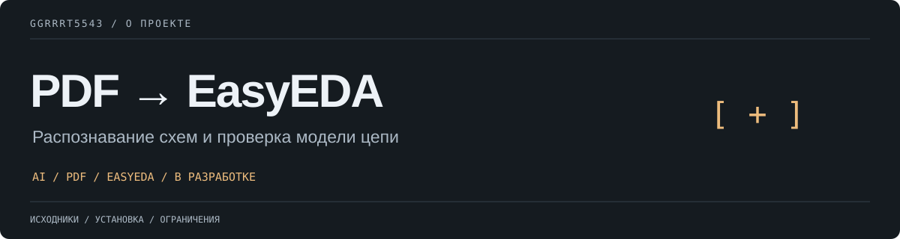

# PDF2EasyEDA AI

Проект для восстановления электронных схем и печатных плат по PDF с помощью ИИ и экспорта в **EasyEDA Standard**.

> [!WARNING]
> Проект активно разрабатывается. Текущая минимальная версия умеет анализировать PDF, обращаться к ИИ-сервисам, строить структурированную модель цепи и проверять извлечённые данные. Генерация полноценных файлов SCH и PCB для EasyEDA пока в разработке.

## Цель проекта

Итоговый сценарий должен быть простым:

1. Выбрать PDF со схемой.
2. Выбрать ИИ-сервис и модель.
3. Ввести свой API-ключ.
4. Нажать кнопку генерации.
5. Получить проверенные файлы EasyEDA.

Ожидаемая структура результата:

```text
output/
├── project_SCH.json
├── project_PCB.json
├── circuit_model.json
└── validation_report.html
```

## Как это работает

```text
PDF
 ↓
Отрисовка страниц и предварительная обработка изображений
 ↓
ИИ-сервис с распознаванием изображений
 ↓
Структурированная модель электрической цепи
 ↓
Проверка компонентов, выводов, соединений и посадочных мест
 ↓
Генерация схемы EasyEDA
 ↓
Контур платы и размещение компонентов
 ↓
Сравнение списков соединений, проверки ERC и DRC
 ↓
Файлы EasyEDA SCH.json и PCB.json
```

ИИ используется для распознавания и интерпретации. За проверку и экспорт отвечает код с явно заданными правилами.

Если сведения отсутствуют или неоднозначны, программа не должна молча додумывать их. Неопределённые компоненты, соединения, номера выводов, посадочные места и полярность должны блокировать итоговый экспорт до уточнения.

## Текущие возможности

- [x] Настольный интерфейс для Windows
- [x] Извлечение страниц PDF
- [x] Поддержка многостраничных PDF
- [x] Адаптер OpenAI и совместимых сервисов
- [x] Адаптер Google Gemini
- [x] Адаптер Anthropic
- [x] Локальный имитатор ИИ-сервиса для тестирования
- [x] Структурированная промежуточная модель цепи
- [x] Проверка компонентов, выводов и соединений
- [x] Блокировка некорректного результата на этапах обработки
- [x] Проверка эталонных форматов EasyEDA и Specctra
- [ ] Генератор схем в собственном формате EasyEDA
- [ ] Автоматический подбор условных обозначений
- [ ] Автоматический подбор посадочных мест
- [ ] Генератор печатных плат в собственном формате EasyEDA
- [ ] Восстановление контура платы
- [ ] Автоматическое размещение компонентов
- [ ] Интеграция автотрассировщика через DSN/SES
- [ ] Автоматические проверки ERC и DRC
- [ ] Полный сценарий в один клик

## Поддерживаемые ИИ-сервисы

- OpenAI и совместимые API
- Google Gemini
- Anthropic Claude
- Локальные и собственные серверы с API, совместимым с OpenAI
- Имитатор сервиса для разработки без подключения к сети

Адаптеры сервисов отделены от основной обработки, чтобы в дальнейшем можно было добавлять новые ИИ-сервисы.

## Установка на Windows

### Требования

- Windows 10 или Windows 11
- Python 3.10 или новее
- Рекомендуется Python 3.12
- API-ключ выбранного ИИ-сервиса

### Установка

Клонируй или скачай репозиторий:

```powershell
git clone https://github.com/ggrrrt5543/EasyEDA-PDF-Builder.git
cd EasyEDA-PDF-Builder
```

Запусти:

```text
install_windows.bat
```

После установки открой приложение:

```text
start_windows.bat
```

## Планируемый сценарий в один клик

1. Открыть приложение.
2. Выбрать исходный PDF.
3. Выбрать ИИ-сервис.
4. Ввести название модели и API-ключ.
5. Выбрать папку результата.
6. Нажать кнопку генерации проекта EasyEDA.
7. Проверить обнаруженные неоднозначности.
8. Получить файлы SCH, PCB и отчёт о проверке.

## Стратегия проверки

Прежде чем считать результат корректным, необходимо проверить:

- Каждый компонент имеет уникальное позиционное обозначение.
- Присутствуют все обязательные свойства компонентов.
- Номера выводов соответствуют условным обозначениям.
- Выводы условных обозначений соответствуют контактным площадкам посадочных мест.
- Каждая электрическая цепь внутренне согласована.
- Соединения не были незаметно добавлены или удалены.
- Выводы питания и цепи питания проверены.
- Определена ориентация полярных компонентов.
- Проверены ориентация разъёмов и положение первого вывода.
- Списки соединений схемы и платы совпадают.
- Не осталось неразрешённых неоднозначностей распознавания.
- Проверка электрических правил ERC завершилась без блокирующих ошибок.
- Проверка правил проектирования DRC завершилась без блокирующих ошибок.
- При включённой автотрассировке не осталось неразведённых соединений.

## Точность и безопасность

PDF — это визуальное представление, а не полный машиночитаемый список соединений. В нём могут отсутствовать подписи, быть изображения низкого разрешения, скрытые соединения, неразборчивые номера выводов или недокументированные посадочные места.

Поэтому преобразование только по PDF не может гарантировать полную электрическую корректность и готовность к производству.

Для повышения точности в дальнейшем могут использоваться:

- Спецификации компонентов BOM
- Готовые списки соединений
- Техническая документация компонентов
- Эталонные файлы SCH/PCB
- Библиотеки посадочных мест
- Фотографии плат

> [!CAUTION]
> Не отправляй автоматически сгенерированную плату в производство без инженерной проверки. Проверь питание, нумерацию выводов, ориентацию разъёмов, полярность компонентов, посадочные места, ERC, DRC и итоговый список соединений. Перед производством собери и протестируй прототип.

## Безопасность API-ключей

- Не храни API-ключи в репозитории.
- Не записывай API-ключи в журналы.
- Используй переменные окружения, защищённое локальное хранилище или временный ввод в память.
- Никогда не добавляй файлы `.env` в коммиты.
- Облачные ИИ-сервисы могут получать страницы PDF и извлечённые данные. Перед обработкой конфиденциальных схем изучи политику приватности сервиса.

Рекомендуемые записи `.gitignore`:

```gitignore
.env
.env.*
.venv/
venv/
__pycache__/
*.pyc
output/
logs/
```

<a id="roadmap"></a>

## План разработки

### v0.1 — Основные этапы обработки

- Разбор PDF
- Адаптеры ИИ-сервисов
- Структурированная модель цепи
- Строгая проверка
- Скрипт запуска для Windows

### v0.2 — Экспорт схемы

- Библиотека условных обозначений
- Формирование соединений
- Экспорт EasyEDA Standard SCH
- Проверка схемы

### v0.3 — Экспорт печатной платы

- Библиотека посадочных мест
- Определение контура платы
- Размещение компонентов
- Экспорт EasyEDA Standard PCB

### v0.4 — Трассировка и проверка

- Экспорт DSN
- Интеграция автотрассировщика
- Импорт SES
- Отчёты ERC и DRC
- Итоговое сравнение списков соединений

### v1.0 — Преобразование в один клик

```text
PDF + API-ключ → проверенные файлы EasyEDA SCH и PCB
```

## Участие в разработке

Приветствуются доработки, тестовые файлы, сообщения об ошибках, библиотеки условных обозначений, соответствия посадочных мест и исследования формата EasyEDA.

Перед загрузкой файлов к сообщению об ошибке удали API-ключи и конфиденциальные сведения о схеме.

## Лицензия

Лицензия MIT. Подробности — в `LICENSE`.

---

Автор и поддержка — [ggrrrt5543](https://github.com/ggrrrt5543). Инструкции, ограничения и сведения о сторонних компонентах приведены выше.
